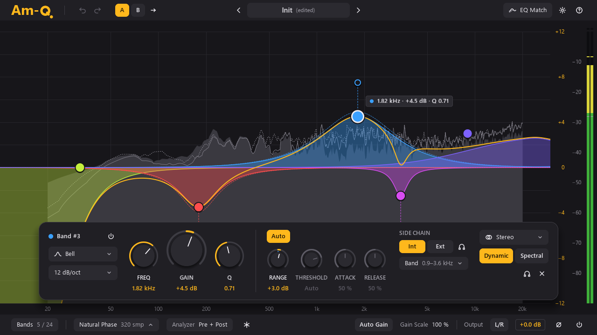
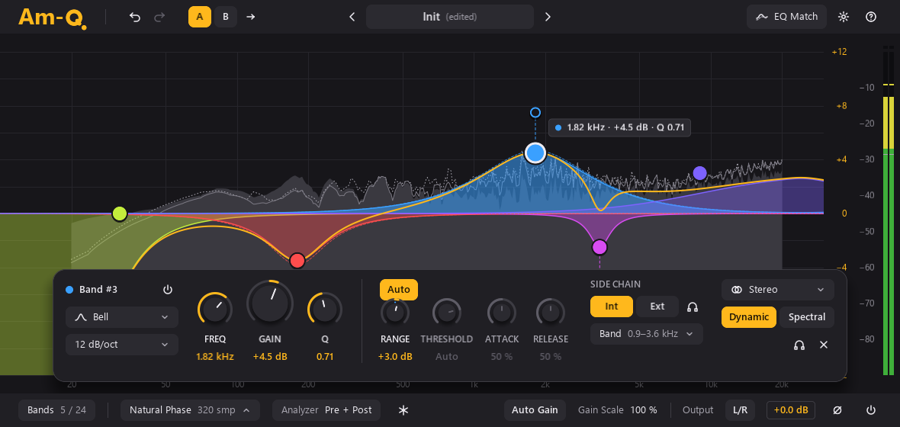
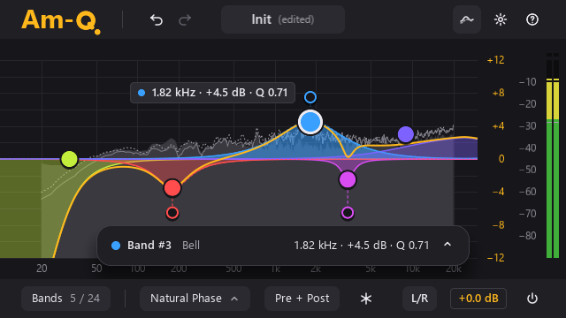
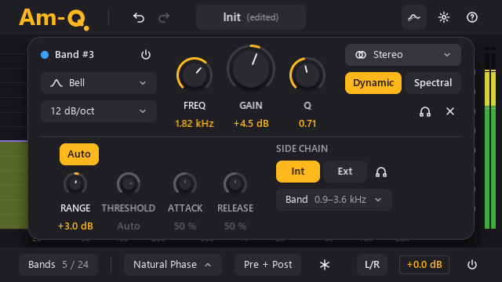

# 1 Getting started

## Requirements

- Windows 10 or 11, 64-bit.
- A plugin host (DAW) that loads CLAP or VST3 plugins.
- Sample rates from 44.1 to 192 kHz. Mono or stereo tracks.

## Installing

Am-Q comes as a zip file named `Am-Q-<version>-windows-x64.zip`. Unzip it, then:

| Format | Copy | To |
| --- | --- | --- |
| CLAP | `Am-Q.clap` | `C:\Program Files\Common Files\CLAP` |
| VST3 | the whole `Am-Q.vst3` folder | `C:\Program Files\Common Files\VST3` |

Then let your host rescan its plugins. Am-Q appears as **Am-Q** (an EQ). Install either format
or both: they sound and behave the same. Most hosts treat the CLAP and the VST3 as separate
plugins, so keep using the one a project was made with.

The zip also holds `INSTALL.txt`, `LICENSE.txt` and `THIRD_PARTY_NOTICES.txt`.

## Loading Am-Q on a track

Insert Am-Q on a mono or stereo track like any effect. It opens with no bands: a flat EQ that
passes audio unchanged. Its window opens at 1280 × 720. Drag the window corner to resize it,
from 640 × 360 up to 3840 × 2160 (see [Small windows](#small-windows) below).

**Side chain.** Am-Q has a second, optional stereo input for an external side chain. Dynamic and
spectral bands can listen to it instead of the track (the band panel's **Ext** switch, chapter 3).
How you route a signal to a plugin's side-chain input depends on your host: in most hosts it is
a send or a "side-chain" input selector on the plugin's slot. In VST3 hosts it appears as an
auxiliary input bus.

**Mono tracks.** On a mono track Am-Q runs as a mono plugin. Bands set to Left, Right, Mid or
Side have no effect there; Stereo bands work as usual.

**Latency.** Am-Q tells the host its latency, and the host compensates for it. In Zero Latency
mode with no spectral band, the latency is 0. See chapter 4 for the other modes.

**Automation.** Every band and output setting can be automated by the host. The analyzer and
display settings are not automatable; they are saved with the project.

**Saving.** Your host saves Am-Q's settings with the project, including the editor's interface
scale and the name of the current preset.

## A tour of the window

From top to bottom:

**The top bar.**

- **Am-Q** wordmark.
- **Undo** and **Redo** (Ctrl+Z, Ctrl+Shift+Z).
- **A**, **B** and the arrow: A/B comparison. They are shown but not active in this version.
- **‹ preset name ›**: the current preset, with "(edited)" once you change something. The arrows
  load the previous or next preset; clicking the name opens the preset menu (chapter 8).
- **EQ Match**: opens EQ Match mode (chapter 7).
- The **gear**: the Analyzer and Interface settings (chapter 6).
- **?**: hint mode, which shows the main gestures in the status bar (chapter 9).

**The graph.** The frequency response you are shaping, drawn over the analyzer.

- The horizontal axis is frequency, 20 Hz to 20 kHz labelled (the graph runs from 10 Hz to
  30 kHz).
- The orange labels at the right edge are the EQ gain scale (±12 dB by default); the grey labels
  beside them are the analyzer level in dB.
- Each band is a coloured dot (a **node**) with its own curve and fill. The thick orange line is
  the sum of every band: what you hear.
- Dynamic bands have a second, small hollow handle on a dashed line: the **range handle**.
- The meters at the right edge show the output level.

**The band panel.** The controls of the selected band. It floats over the bottom of the graph and
appears when a band is selected (chapter 3).

**The status bar.**

- **Bands 5 / 24**: how many of the 24 bands are in use. Click it for the band list.
- **Processing mode** and its latency, for example "Natural Phase 320 smp". Click it for the
  Processing menu (chapter 4).
- **Analyzer**: which spectra are shown ("Pre + Post"). Click it for the analyzer settings.
- The **snowflake** freezes the analyzer.
- **Auto Gain**, **Gain Scale 100 %**, **Output**, the pan mode chip (**L/R** or **M/S**), the
  output level (**+0.0 dB**), **invert polarity** and **bypass** (chapter 5).

## Your first band

1. Move the pointer over the graph. A dashed circle with a plus sign follows it, with the
   frequency and gain under the pointer.
2. Double-click. A Bell band appears there, selected, and its panel opens.
3. Drag the node: left and right change the frequency, up and down the gain.
4. Turn the mouse wheel over the node to change its width (Q).
5. Right-click the node for the band menu, or use the panel to change its shape.

Chapter 2 covers every way of working on the graph.

## Small windows

Am-Q keeps its controls at full size and gives any extra room to the graph. As the window
shrinks, it makes space in steps:

- Below 1100 pixels wide, the EQ Match button shows only its icon. Further down, less used items
  move into menus: Gain Scale, Invert and Auto Gain stay available in the Output menu, and the
  latency stays in the Processing menu.
- When the graph is shorter than 520 pixels (or narrower than 680), the band panel becomes
  **compact**: smaller knobs, same controls.

  

- When the graph is shorter than 400 pixels, the panel folds into a **strip** that shows the band,
  its shape and its frequency, gain and Q. Click the chevron at its right end to open the full
  panel over the graph; it folds back when you select another band, or press Escape.

  

  

To make everything bigger instead, use the interface scale (chapter 6).
