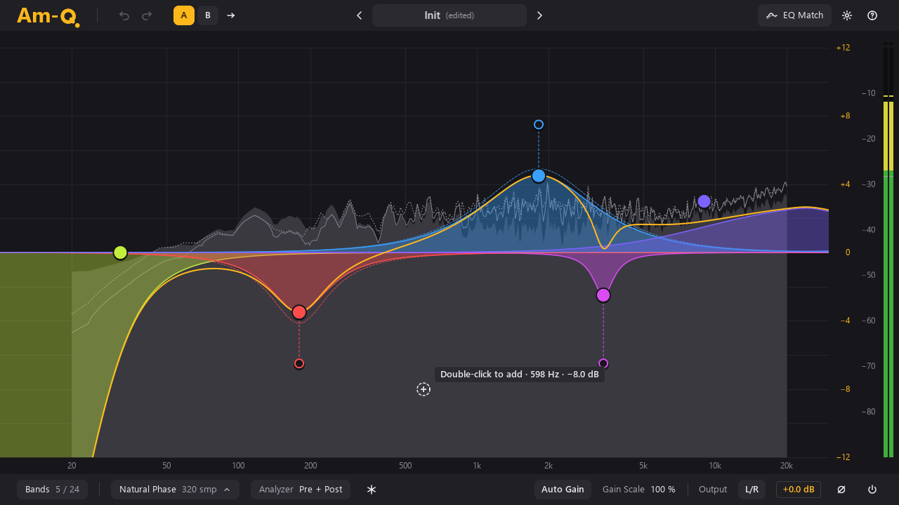
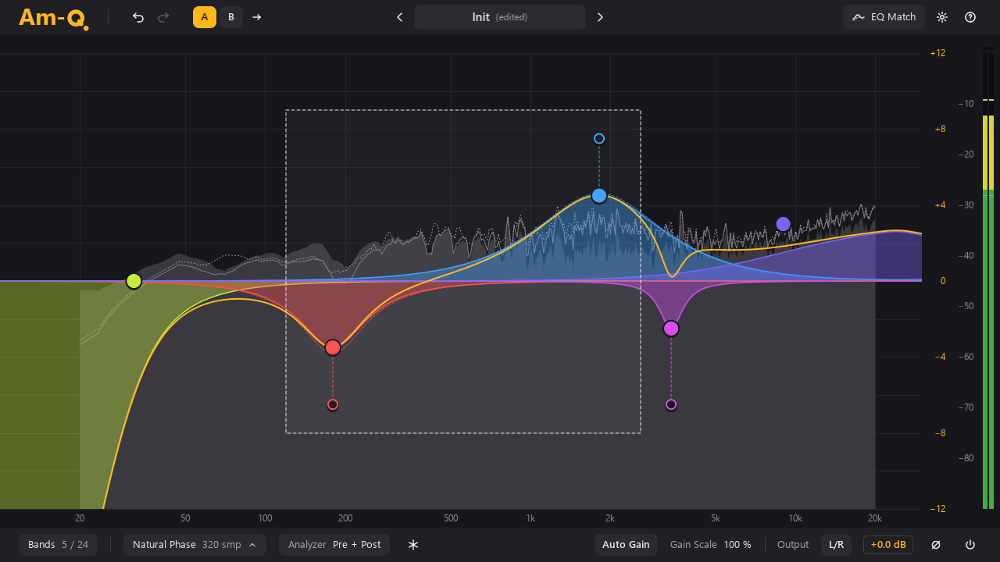
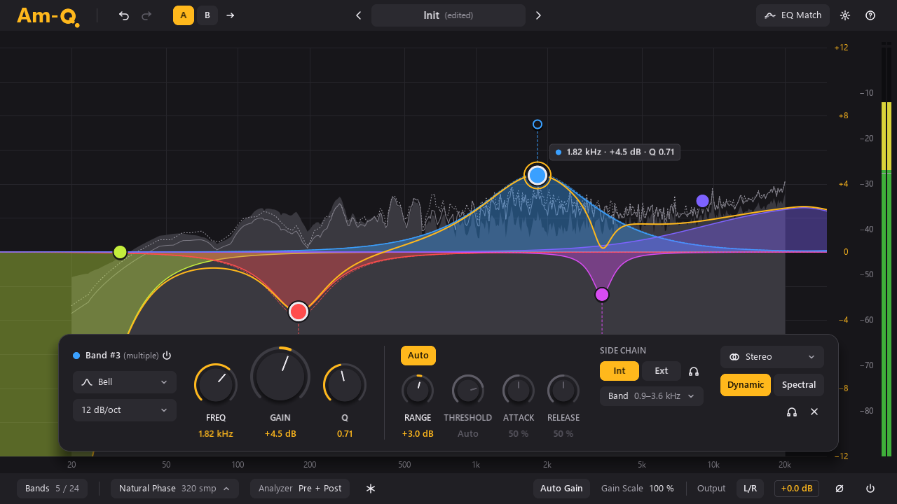
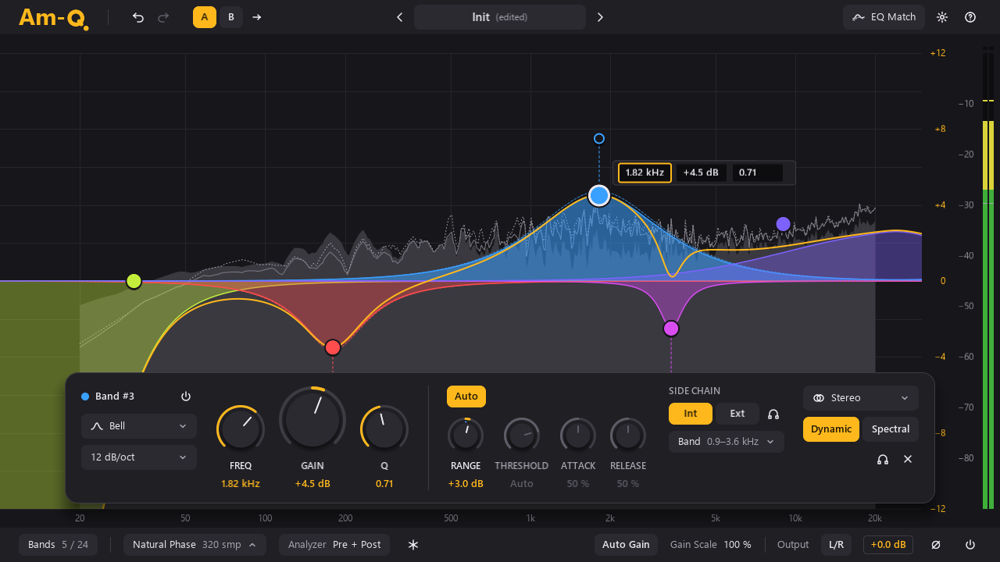
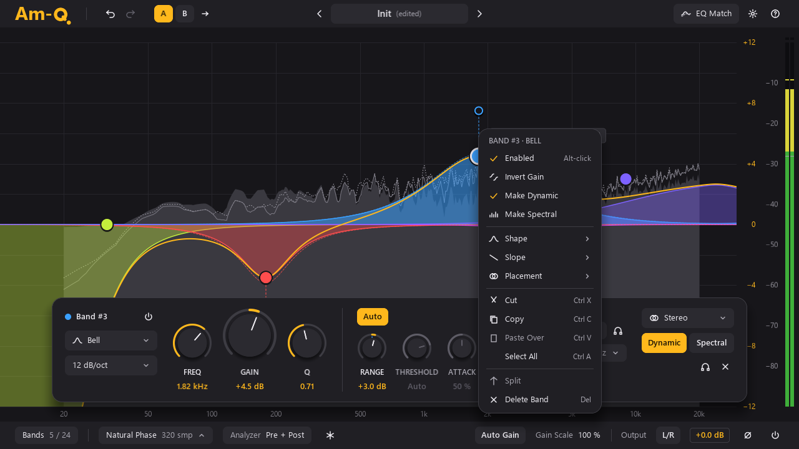

# 2 Working on the graph

Most work in Am-Q happens directly on the graph. Every change you make here is one step in the
undo history, and the host records it as automation if you are writing automation.

## Adding a band

Double-click an empty part of the graph. A **Bell** band appears at that frequency and gain,
with every other setting at its default. Before you click, the pointer shows a dashed circle with
a plus sign and the readout "Double-click to add", with the frequency and gain under the pointer.

Am-Q has 24 bands. When all 24 are in use, a double-click adds nothing until you delete one.

## Selecting bands

| To | Do |
| --- | --- |
| Select a band | Click its node. It grows, gets a white ring, and its panel opens. |
| Add a band to the selection | Shift-click its node. |
| Add or remove a band from the selection | Ctrl-click its node. |
| Select several bands at once | Drag across empty graph: a dashed rectangle (a lasso) selects every node inside it. Hold Shift to keep the bands already selected. |
| Select all bands | Ctrl+A, or **Select All** in the band menu. |
| Select nothing | Click empty graph, or press Escape. |

With several bands selected, the panel shows the **focused** band (the last one you clicked),
marked "(multiple)". The panel changes only that band. Dragging, the mouse wheel, the keyboard and
the band menu change every selected band.

## Moving and shaping a band

**Drag a node.**

- Left and right change the frequency; up and down change the gain.
- For bands without gain (Low Cut, High Cut, Notch, Band Pass, All Pass), up and down change Q
  instead.
- With several bands selected, they all move by the same amount (the same number of octaves
  and the same number of dB).
- A press that moves less than 3 pixels is a click, not a drag.

**Modifiers while dragging a node.**

| Hold | Effect |
| --- | --- |
| Shift | Fine: every movement is a tenth as large. |
| Alt | Up and down change Q instead of gain. |
| Ctrl | Locks the drag to the direction you moved first (frequency only, or gain only). |
| Escape | Cancels the drag: the band goes back to where it was. |

**The mouse wheel**, over a node (or anywhere on the graph while bands are selected):

| Wheel with | Changes |
| --- | --- |
| nothing | Q |
| Ctrl | Gain, 0.5 dB per notch |
| Alt | Dynamic range (dynamic bands), 0.5 dB per notch |
| Ctrl+Alt | Slope, one step per notch (only slopes the shape allows) |
| Shift, added to any of the above except slope | Fine: a tenth of the step |

Wheel up always raises the value.

**The range handle.** A dynamic band has a second, hollow handle on a dashed line above or below
its node. Drag it up or down to set the band's dynamic range: how far the band's gain may move
when the signal crosses the threshold. Chapter 3 explains dynamics.

**Readouts.** The selected band shows a readout next to its node: frequency, gain and Q, for
example "1.82 kHz · +4.5 dB · Q 0.71". It follows the node while you drag.

## Typing exact values

Double-click a node to edit its values as text. A small editor replaces the readout with one field
per value (frequency, gain and Q, as the shape has them). The frequency field starts selected.

- Type a value and press **Enter** to apply it.
- **Tab** applies the field and moves to the next one.
- **Escape** cancels.
- Clicking elsewhere applies the values.

Am-Q understands the forms you would naturally type: "1.2k", "1200", "1.2 kHz", "-3", "−3",
"+3 dB". If a field cannot be read, its outline turns red and nothing is changed until you fix
it or cancel.

The same editor opens when you click the value under any knob in the band panel, and when you
double-click an editable readout such as the output level.

## Enabling and disabling bands

Alt-click a node to switch its band off or on. A disabled band is drawn hollow and faded, and it
no longer affects the sound or the summed curve, but it keeps all its settings. The band panel's
power button and the band menu do the same.

Alt-click a **range handle** to switch the band's dynamics off or on.

## The band menu

Right-click a node, or anywhere on the graph while bands are selected. The menu acts on the
selected bands, or on the band you right-clicked if it is not selected. Its caption names the
targets, for example "BAND #3 · BELL" or "2 BANDS · #2, #3".

| Item | Does |
| --- | --- |
| **Enabled** | Switches the bands off or on. A dash instead of a check means some are on and some off. |
| **Invert Gain** | Turns boosts into cuts and cuts into boosts (the gain and the dynamic range change sign). |
| **Make Dynamic** | Makes the bands dynamic (checked when they all are). Choosing it again removes the dynamics. A band with no range set gets −6 dB. |
| **Make Spectral** | Makes the bands spectral, which also makes them dynamic. Choosing it again removes spectral processing. |
| **Shape ›** | Changes the filter shape (chapter 3). |
| **Slope ›** | Changes the slope, in a grid of the slopes the shapes allow. |
| **Placement ›** | Stereo, Left, Right, Mid or Side (chapter 3). |
| **Cut** (Ctrl+X) | Copies the bands, then deletes them. |
| **Copy** (Ctrl+C) | Copies the bands. |
| **Paste** / **Paste Over** (Ctrl+V) | Pastes copied bands into free bands. With bands selected it reads **Paste Over** and replaces them. Greyed out when nothing has been copied. |
| **Select All** (Ctrl+A) | Selects every band. |
| **Split** | Not available in this version (always greyed out). |
| **Delete Band** (Delete) | Deletes the bands. |

Right-click **empty graph with nothing selected** for the graph menu: **Select All**, **Paste**,
**Delete Disabled Bands** and **Delete All Bands**.

**Copy and paste between instances.** Copied bands go to the system clipboard as text, so you can
paste them into another Am-Q instance, in the same project or another. Pasted bands keep every
setting. If there are not enough free bands, Am-Q says so and pastes nothing.

## Deleting bands

Select the bands and press **Delete** or **Backspace**, use **Delete Band** in the band menu, or
click the **×** in the band panel. A deleted band goes back to its defaults; undo brings it back.

## Zooming the frequency axis

Turn the mouse wheel over empty graph, with no band selected, to zoom the frequency axis in or
out around the pointer. The axis never goes beyond 10 Hz to 30 kHz. Wheel the other way to zoom
back out.

## Undo and redo

**Ctrl+Z** undoes the last change; **Ctrl+Shift+Z** or **Ctrl+Y** redoes it. The arrows in the
top bar do the same. Every gesture is one step: a whole drag, a menu command, an EQ Match apply.
Am-Q keeps the last 100 steps. Host automation and loading a preset are not undo steps, and
loading a preset or project clears the history.
