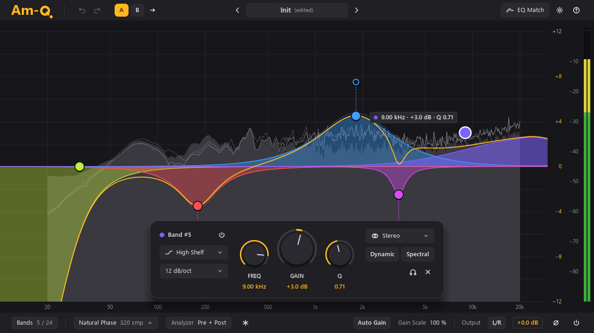
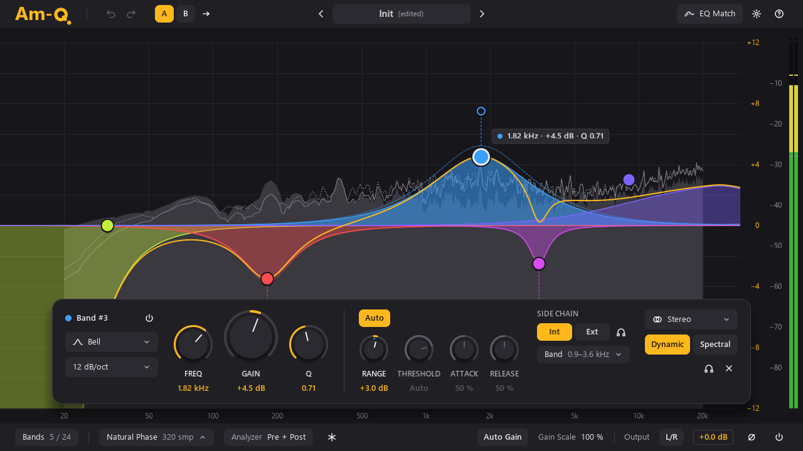
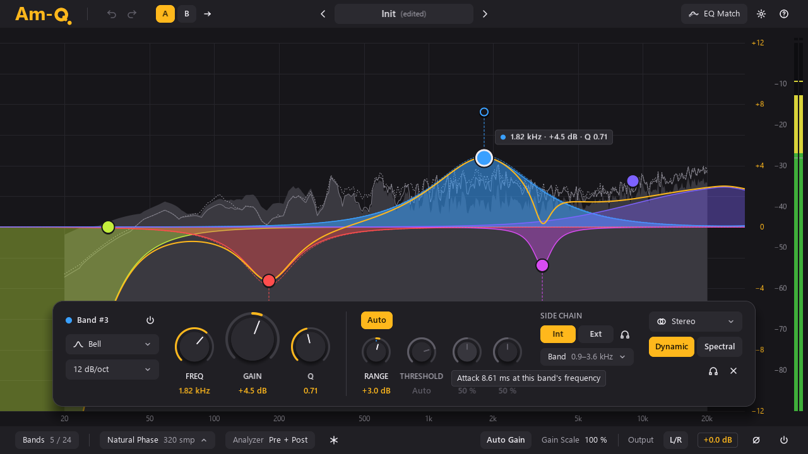
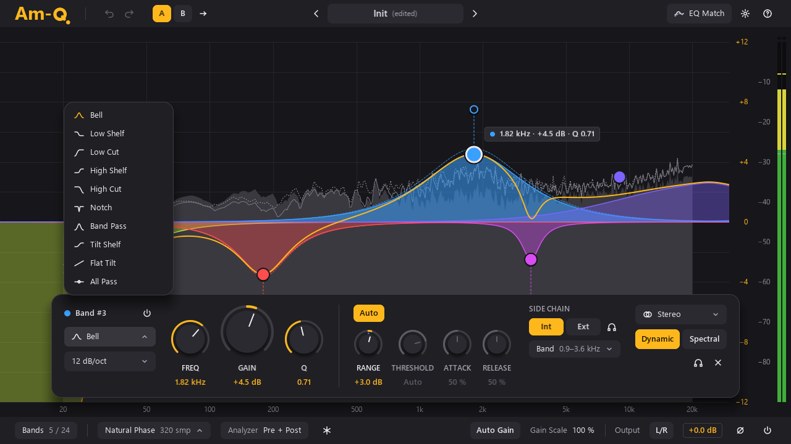
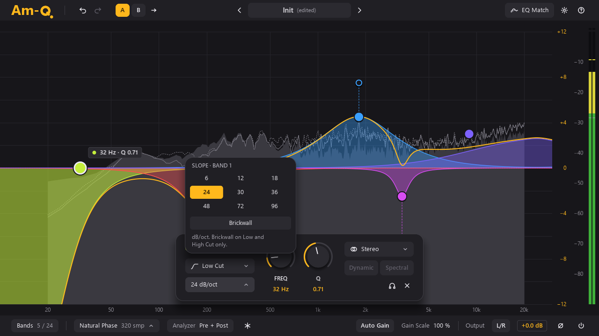
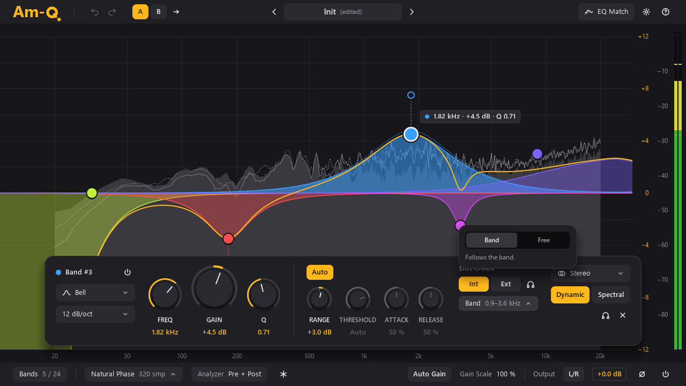
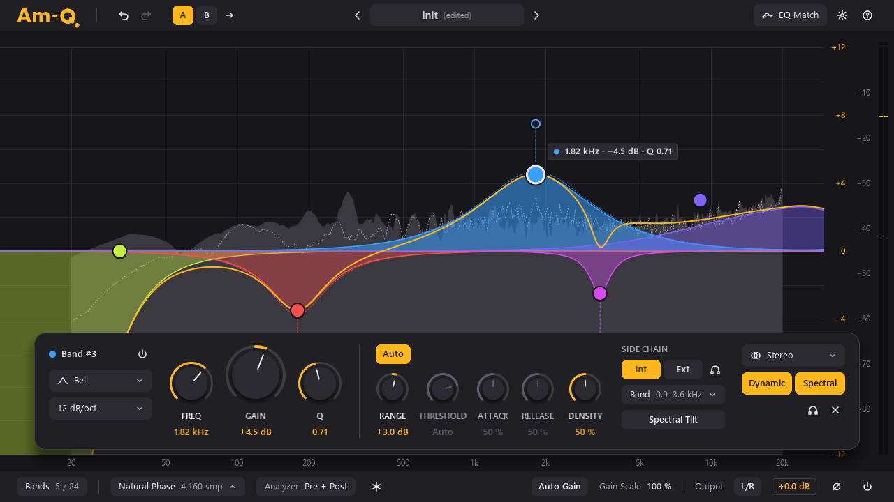
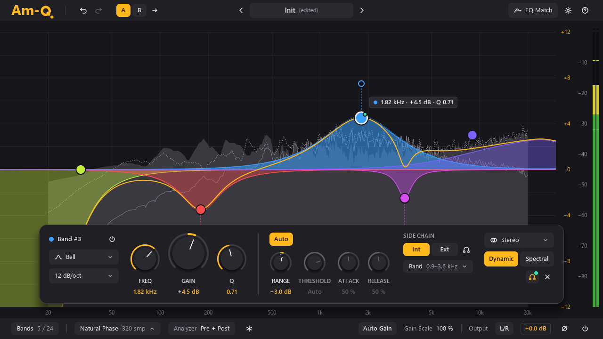

# 3 The band panel

Select a band to open its panel. The panel shows only the controls that mean something for that
band, so it changes width as you change the band's shape or make it dynamic.

**Using the controls.**

- **Knobs:** drag up or down; hold Shift for fine steps. Double-click a knob to reset it to its
  default. Click the value under a knob to type a value.
- **Selects** (the boxes with a small arrow) open a menu.
- **Chips** (Auto, Int, Ext, Dynamic, Spectral, Spectral Tilt) switch on (orange) and off.
- Hover over any control for a tooltip. Attack and Release show the actual time they give at the
  band's frequency.

The panel's columns, from left to right:

## Band identity

- **Band #N** with the band's colour. With several bands selected, "(multiple)" follows it.
- **Power button:** switches the band off and on (the same as Alt-clicking its node). A disabled
  band's panel stays editable.
- **Shape:** the filter type (below).
- **Slope:** how steep the filter is (below). Hidden for Flat Tilt.

## Shapes

| Shape | What it does | Gain | Q | Slope |
| --- | --- | --- | --- | --- |
| **Bell** | Boosts or cuts a region around the frequency. | yes | width of the bell | steepness of its skirts |
| **Low Shelf** | Boosts or cuts everything below the frequency. | yes | shape of the corner | steepness |
| **Low Cut** | Removes everything below the frequency (a high-pass filter). | no | resonance at the corner | steepness |
| **High Shelf** | Boosts or cuts everything above the frequency. | yes | shape of the corner | steepness |
| **High Cut** | Removes everything above the frequency (a low-pass filter). | no | resonance at the corner | steepness |
| **Notch** | Removes a narrow region at the frequency. | no | width of the notch | steepness |
| **Band Pass** | Keeps only a region around the frequency. | no | width of the band | steepness |
| **Tilt Shelf** | Tilts the whole spectrum around the frequency: the gain is split half below, half above (+6 dB gives −3 dB below and +3 dB above). | yes | shape of the transition | steepness |
| **Flat Tilt** | A straight, constant tilt from 20 Hz to 20 kHz, pivoting at the frequency. The gain is the total tilt across that range (10 dB is about 1 dB per octave). | yes | not used | not used |
| **All Pass** | Leaves the level untouched and shifts the phase around the frequency. | no | how fast the phase turns | order |

**What Q means.**

- On Bell, Notch and Band Pass, Q is the width: the centre frequency divided by the bandwidth.
  Higher Q is narrower. A Bell's width does not change with its gain.
- On cuts, shelves and Tilt Shelf, Q shapes the corner. **Q 1 is the smooth, standard corner.**
  Lower values soften it; higher values add a resonant bump at the corner. The range goes up to
  Q 40 on every shape, and at the top a shelf or cut has a very large bump (tens of dB), so use
  high values deliberately.
- 6 dB/oct shapes have no corner to shape, so Q has no effect on them.

## Slopes

The slope picker offers 6, 12, 18, 24, 30, 36, 48, 72 and 96 dB per octave, and **Brickwall**.
Higher slopes are steeper. Options a shape does not allow are greyed out. **Brickwall** is a very
steep cut, available on Low Cut and High Cut only.

## Frequency, gain and Q

- **FREQ:** 10 Hz to 30 kHz.
- **GAIN:** −30 to +30 dB. Shown only for shapes with gain.
- **Q:** 0.025 to 40, on a logarithmic control (each equal turn of the knob is the same ratio of
  Q). Shown for every shape except Flat Tilt.

If **Gain Scale** (chapter 5) would push a band beyond ±30 dB, the band stops at ±30 dB.

## Placement

The **Placement** select (two rings) chooses which part of a stereo signal the band works on:

| Placement | Affects |
| --- | --- |
| **Stereo** | Both channels, with the same gain on both. |
| **Left** / **Right** | One channel only. |
| **Mid** | What the two channels have in common: the centre of the stereo image. |
| **Side** | What differs between the channels: the width of the stereo image. |

Am-Q converts to mid and side only while a Mid or Side band is in use, and the conversion is
exact, so using it costs nothing in quality. On a mono track, only Stereo bands have an effect.

## Dynamic and Spectral

Two chips in the panel's right column change how the band behaves over time:

- **Dynamic:** the band's gain follows the level of the signal (below).
- **Spectral:** the band's dynamics act separately on many narrow frequency slices (below).
  Turning Spectral on also turns Dynamic on.

Only shapes with gain can be dynamic or spectral; for others the chips are greyed out.

## Dynamics

A dynamic band moves between two settings: its **gain**, while the signal is quiet, and its
**gain + range**, while the signal is loud. How far it moves depends on how far the signal goes
above the **threshold**, with a soft knee, so the change sets in gradually.

- **Range** (−30 to +30 dB): how far, and which way, the gain can move. Negative values cut
  when the signal gets loud (like a compressor on that region); positive values boost it.
  The range handle on the graph shows where the band goes at full range. When you make a band
  dynamic with no range set, it gets −6 dB.
- **Auto** (on by default): Am-Q sets the threshold itself, relative to a slow average of the
  side-chain level, so the band reacts to what stands out from the rest of the material rather
  than to an absolute level. It settles within about half a second. While Auto is on, Threshold,
  Attack and Release are greyed out and a standard timing applies. Your own settings are kept
  and come back when you turn Auto off.
- **Threshold** (−90 to 0 dB): the level above which the band starts to move. Greyed out, and
  shown as "Auto", while Auto is on.
- **Attack** (0–100 %): how fast the band reacts to a rise in level, from about 0.25 ms to
  250 ms. At the same setting, low bands react more slowly than high bands, so bass is not
  distorted by a too-fast attack. The tooltip shows the actual time.
- **Release** (0–100 %): how fast the band returns, from about 5 ms to 1 s. Release is
  programme-dependent: short peaks recover quickly, while sustained gain changes recover at the
  Release time or slower.

**Seeing it work.** While the band moves, the graph draws its live curve, and the Range knob shows
the current gain change as a second, inner arc in the band's colour.

On Stereo placement, both channels are detected together and get the same gain, so the stereo
image stays put.

## Side chain

The **SIDE CHAIN** column appears with the dynamics. It sets what the band listens to.

- **Int / Ext:** **Int** listens to the track itself. **Ext** listens to Am-Q's external
  side-chain input, so another track can drive this band (for example a kick drum ducking the
  bass in its own region). Your host has to route a signal to the side-chain input (chapter 1).
- **Listen** (headphones): you hear the side-chain signal through the band's side-chain filter,
  so you can hear exactly what the band is reacting to. Turn it off to hear the result again.
- **Filter** ("Band 0.9–3.6 kHz"): which frequencies of the side chain are measured. Click it to
  choose:
  - **Band:** follows the band itself (the default).
  - **Free:** you set a **Low** and **High** frequency yourself. While the popover is open, the
    range is drawn over the graph.

## Spectral processing

A spectral band does not move its whole region at once. It splits the region into many narrow
slices and gives each slice its own dynamics, so only the frequencies that actually stick out
are cut (or boosted). It suits resonances that move, harsh sibilance, or a crowded region where a
normal dynamic band would also pull down everything around the problem.

- **Density** (0–100 %): how narrow the slices are, from about 1/4 octave at 0 to about
  1/16 octave at 100, finer at high frequencies.
- **Spectral Tilt:** lowers the threshold for the higher slices of the band (by 3 dB per octave
  above its centre), so the highs of a band are treated as sensitively as its lows; music
  usually has less energy up there.
- Threshold, Attack, Release, Range and the side chain work as for a dynamic band, for each
  slice.

Spectral processing works on blocks of audio, so **any spectral band adds latency** in every
processing mode (chapter 4). The status bar's latency reading shows it.

## Solo

The **Solo** button (headphones, at the bottom right of the panel) lets you hear only this band's
region. Bells and notches play through a band-pass filter at the band's frequency, as wide as its
Q; a boosted Bell's solo includes its boost.

- While a band is soloed, a green dot marks the Solo button and the band's node.
- Drag the soloed node up or down to change the **Solo Gain** (the audition level, ±20 dB). It is
  also in the Output menu (chapter 5).
- Solo is a listening aid: switch it off to hear the full mix again.

## Delete

The **×** deletes the band (one undo step).
