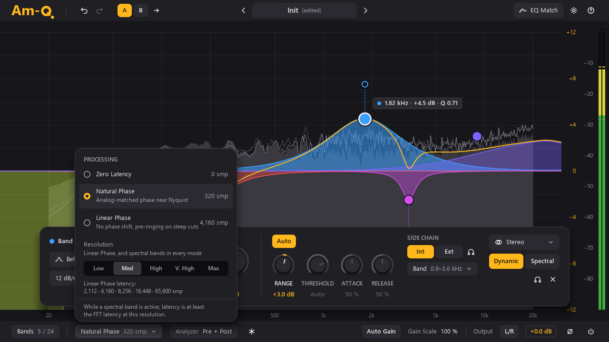

# 4 Processing modes and latency

Click the processing select in the status bar ("Natural Phase 320 smp") to choose how Am-Q
processes the bands. The menu stays open while you choose, so you can see the latency change.

The three modes sound the same in level (every mode follows the same curves); they differ in
**phase** and **latency**.

## Zero Latency

The bands are digital filters that respond instantly. Latency is **0 samples**, so it suits
tracking, live use and monitoring. Like every zero-latency EQ, its phase shifts around each band,
and near the top of the spectrum (close to half the sample rate) that phase differs from the
analog filter it models.

## Natural Phase

The same filters, followed by a short correction that makes the **phase** follow the analog
filter all the way up to the top of the spectrum: the boost or cut sounds the way the analog
shape would, also near the highest frequencies. Latency is **320 samples** at every sample rate
(6.7 ms at 48 kHz), and it does not change as you add or move bands.

**Brickwall cuts in Natural Phase.** Low Cut and High Cut bands with the Brickwall slope are left
out of the correction and keep their normal response. They sound and measure the same as in Zero
Latency, delayed by the Natural Phase latency like everything else, and their steep edge rings
slightly after transients, as any steep zero-latency filter does. For a steep cut with no phase
shift at all, use Linear Phase.

## Linear Phase

Every band is combined into one filter with **no phase shift at all**: the EQ changes only the
level of each frequency. The cost is latency, and **pre-ringing**: a steep cut or a narrow band
"smears" a little sound before sharp transients, which can soften drums at extreme settings.

**Resolution** sets the length of that filter. Higher resolutions are more accurate at low
frequencies and with narrow bands, and add latency:

| Resolution | Latency at 44.1 and 48 kHz |
| --- | --- |
| Low | 2,112 samples |
| Med (default) | 4,160 samples |
| High | 8,256 samples |
| V. High | 16,448 samples |
| Max | 65,600 samples |

At 88.2 and 96 kHz the latency doubles, and at 176.4 and 192 kHz it doubles again, so the
frequency resolution stays about the same. The menu shows the latencies for the session's actual
sample rate.

## Spectral bands and latency

Spectral bands (chapter 3) process audio in blocks, in every mode. While at least one spectral
band is active, the latency is at least the spectral latency at the current **Resolution**
(the resolution setting applies to spectral bands in every mode, not only to Linear Phase).
The status bar always shows the latency in use.

## Changing mode during playback

When a change alters the latency (switching mode, changing the Linear Phase resolution, or the
first spectral band switching on or the last one off), Am-Q fades its output out, tells the host
the new latency, and fades back in. Hosts handle this differently: most compensate at once, some
only when playback stops and starts again. Set the mode before you mix, and avoid automating it.

Bypass, by contrast, never changes the latency (chapter 5).

## Which mode to use

- **Zero Latency** while recording or playing live, and whenever latency matters.
- **Natural Phase** for mixing: analog-like phase with a small, fixed latency. A good default.
- **Linear Phase** for mastering, parallel processing (where phase shifts between tracks would
  cause cancellation) or steep corrective cuts, when the latency is acceptable.

## CPU

Am-Q is designed to stay light. As a guide, measured on a current desktop CPU at 48 kHz with
24 bands in use: about 1.5 % of one core at 12 dB/oct in Zero Latency or Natural Phase, rising
to about 3.5 % with every band at 96 dB/oct; about 2.2 % in Linear Phase at Med; about 3.5 % with
every band dynamic and about 3 % with every band spectral. Automating many bands at once adds a
little. An open editor with the analyzer off uses well under 1 %.
