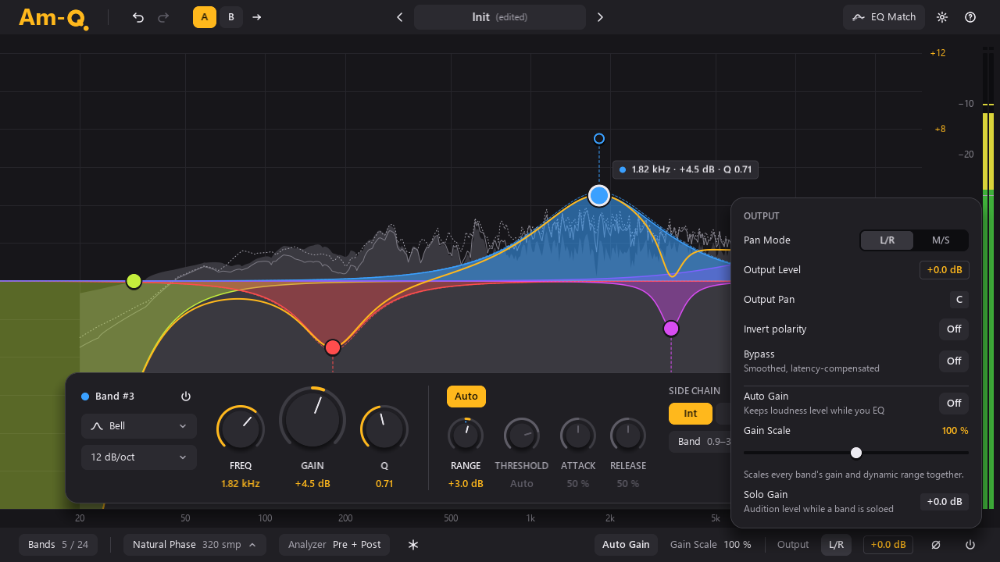

# 5 Output, gain and bypass

The right side of the status bar holds the output controls. Click the pan mode chip (**L/R** or
**M/S**) to open the **Output** menu, which has all of them, including those the status bar hides
in a narrow window. The menu stays open while you use it.

## Output Level

The level after the EQ, from −∞ (silence) through −36 dB up to **+36 dB**, default 0 dB. Drag
the value up or down (Shift for fine steps), or double-click it to type a value. Between −36 dB
and +36 dB the control is even in dB; in the bottom part of its travel it fades smoothly to
silence, which makes fades with host automation sound natural. Silence is shown as "−∞ dB".

## Output Pan and Pan Mode

**Output Pan** balances the output, from full left to full right. It only ever turns a side down,
never up, so panning cannot clip. "C" is centre; values read like "12.0 L".

**Pan Mode** changes what the pan control balances:

- **L/R:** left against right, as usual.
- **M/S:** mid against side. Turning towards **S** lowers the mid, so the image gets wider;
  turning towards **M** lowers the side, and at the far end the output is mono. Values then read
  like "30.0 S".

Switching Pan Mode crossfades, so it does not click.

## Invert polarity

Flips the polarity of the output (both channels). Useful for checking phase against another
track. The status bar's Ø button does the same.

## Bypass

Turns the whole EQ off, smoothly, without changing the latency: the bypassed signal is delayed
by exactly the same amount, so switching bypass on and off during playback compares like for
like with no jump in time. Fully bypassed, Am-Q passes the input through bit for bit (after that
delay). The status bar's power button does the same, and so does your host's own bypass.

## Auto Gain

Keeps the loudness about the same while you EQ, so you judge the change in tone and not in level
(a boost tends to sound better simply because it is louder). Am-Q works out the gain from the
curve you have drawn, not from the audio, so it does not pump or react to the music; it ignores
the extreme lows and highs, which matter little for perceived loudness. It can make up at most
30 dB.

Auto Gain is off by default. It is in the status bar and the Output menu.

## Gain Scale

Scales the gain **and** the dynamic range of every band together, from 0 % to 200 %:

- **100 %** is the curve as drawn.
- **50 %** halves every boost and cut: a quick way to make a whole EQ subtler.
- **0 %** flattens the EQ, while keeping the shapes, so you can bring it back.
- **200 %** doubles everything (each band still stops at ±30 dB).

Drag the slider in the Output menu, or drag the value in the status bar (double-click to type).

## Solo Gain

The level of the solo audition (chapter 3), from −20 to +20 dB, default 0 dB. It applies only
while a band is soloed. You can also change it by dragging the soloed node up and down.

## The meters

The two meters at the right edge of the graph show the output level of the left and right
channels, over the top 60 dB:

- The bar is the peak level: green below −18 dBFS, yellow from −18 to −3 dBFS, red above −3 dBFS.
- A short yellow line is the peak hold; a thin grey line is the average (RMS) level.
- The small light above each meter turns red when that channel went over 0 dBFS. It stays lit
  until you close and reopen the editor.
