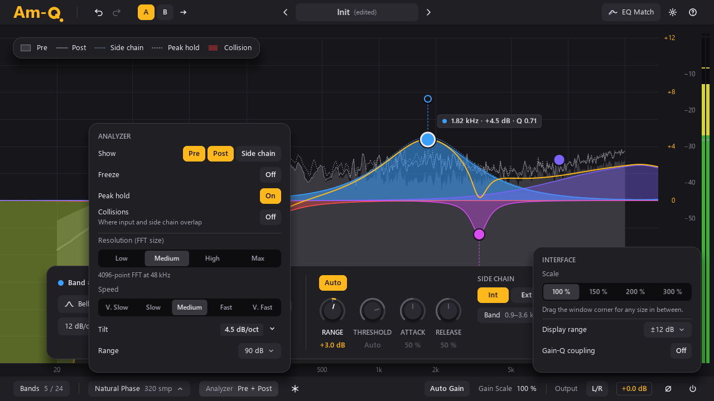

# 6 Analyzer, meters and display

## The analyzer

Behind the EQ curves, Am-Q shows the spectrum of the audio:

- **Pre** (grey fill): the input, before the EQ.
- **Post** (light line): the output, after the EQ.
- **Side chain** (dashed blue line): the external side-chain input, when one is connected.
- **Peak hold** (dotted line): the highest recent level of the output at each frequency.
- **Collisions** (red hatching): where the input and the side chain are both strong at the same
  frequencies. Useful for finding where two sources fight, for example before setting up a
  side-chained dynamic band.

The analyzer's level scale is the grey labels at the right edge (0 dB at the top).

**Freeze.** The snowflake in the status bar (or **Freeze** in the Analyzer panel) holds the
current spectrum so you can study it. A "Frozen" chip appears in the top bar; click it to
unfreeze.

## Analyzer settings

Click **Analyzer** in the status bar for the Analyzer panel, or the gear in the top bar for the
Analyzer and Interface panels together. While the Analyzer panel is open, a legend at the top
left of the graph names each layer.

| Setting | Choices | What it does |
| --- | --- | --- |
| **Show** | Pre, Post, Side chain (Pre and Post on by default) | Which spectra are drawn. |
| **Freeze** | On / Off | Holds the spectrum. |
| **Peak hold** | On / Off (On) | Shows or hides the peak-hold line. |
| **Collisions** | On / Off (Off) | Shows where the input and the side chain overlap. |
| **Resolution (FFT size)** | Low, Medium, High, Max | More resolution shows more detail at low frequencies, and reacts a little more slowly. The caption shows the actual size, for example "4096-point FFT at 48 kHz". |
| **Speed** | V. Slow, Slow, Medium, Fast, V. Fast | How quickly the display follows the audio: slow is steady and easy to read, fast shows transients. |
| **Tilt** | 0 to 6 dB/oct (4.5) | Tilts the display so that typical music, which has less energy at high frequencies, looks roughly flat. Only the display changes, not the sound. Drag the value, or use its arrow for 0, 1.5, 3, 4.5 or 6. |
| **Range** | 60, 90, 120 dB (90) | The level span of the analyzer, from 0 dB down. |

The analyzer settings are saved with the project and with presets, but are not automatable.

## Interface settings

| Setting | Choices | What it does |
| --- | --- | --- |
| **Scale** | 100 %, 150 %, 200 %, 300 % | Makes the whole interface larger. Am-Q asks the host to resize the window to match; if the host refuses, the content scales within the current window. Drag the window corner for any size in between. The scale is saved with the project. |
| **Display range** | ±3, ±6, ±12, ±30 dB (±12) | The gain span of the graph. Use ±3 or ±6 for fine, gentle EQ, and ±30 to see large cuts. Only the display changes. |
| **Gain-Q coupling** | On / Off (Off) | While on, dragging a band's gain also narrows or widens it: every 12 dB more boost or cut doubles its Q. Many classic EQs behave this way. |

Am-Q also follows Windows' display scaling, so on a high-resolution screen it is sharp at any
size. If Windows' "Show animations" setting is off, Am-Q's menus and highlights appear without
animation.
