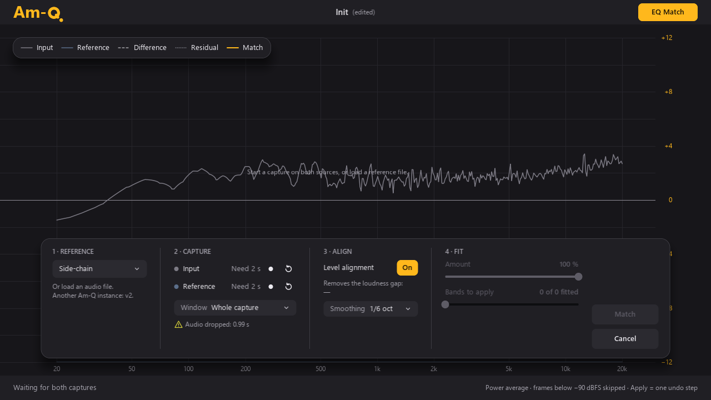

# 7 EQ Match

EQ Match compares the long-term tonal balance of your track with a reference (another track, a
mix you like, or an audio file), and builds an EQ curve from free Am-Q bands that brings your
track towards the reference. The result is ordinary bands you can edit afterwards.

Click **EQ Match** in the top bar to enter EQ Match mode. The band panel is replaced by the EQ
Match panel, the graph shows the match layers, and the bars switch to a simpler view. Graph
editing is paused (zooming the frequency axis still works).

The panel's four columns are the four steps, left to right.

## 1 · Reference

Choose what to match **to**:

- **Side-chain:** the reference plays into Am-Q's external side-chain input. Route the reference
  track to the side chain in your host (chapter 1) and play it with your track.
- **Audio file…:** opens a file dialog. Choose a WAV file (up to 20 minutes, any sample rate,
  mono or multichannel). Am-Q analyses the whole file; a thin line under the select shows the
  progress. Once analysed, the reference is ready, and you only need to capture your own track.

## 2 · Capture

Two rows, **Input** (your track) and **Reference**, each with:

- the captured time, for example "12.4 s", or "Need 2 s" until there is enough (2 seconds);
  hover over it to see the number of analysis frames;
- a **record** button (the dot): click to start capturing, click again to pause. Captures
  accumulate across pauses, so you can capture several passages;
- a **reset** button (the circular arrow): clears that capture.

Play the material while recording. Silent passages (below −90 dBFS) are skipped automatically,
so stopping the transport does not spoil the capture. A tick appears when a capture is ready.

**Window:** **Whole capture** (default) averages everything captured. **Last N s** (1 to
60 seconds) keeps only the most recent N seconds, useful when you play through a song and want to
match one section.

If the host fails to deliver audio for a while (for example while it is busy loading), Am-Q
shows "Audio dropped" with the missing time under the capture rows. The capture stays valid; the
note tells you some audio was not included. (In the screenshot above it comes from the tool that
took the screenshot, not from a real session.)

## 3 · Align

- **Level alignment** (On by default): removes the overall loudness difference between the two
  captures, so the match changes only the tonal balance and does not add a big overall boost or
  cut. The caption shows the difference removed, for example "Removes the loudness gap: −2.4 dB".
- **Smoothing:** how much detail the match follows: **1/3**, **1/6** (default), **1/12** or
  **1/24 octave**. Coarser smoothing gives a broad, musical match with few bands; finer smoothing
  follows narrow differences.

## 4 · Fit and apply

The primary button steps through the process:

1. **Match** (available once both captures are ready, or the reference file is analysed): Am-Q
   fits bands to the difference. The status bar shows the progress.
2. **Stop**, while fitting: cancels, and nothing changes.
3. **Apply:** writes the fitted bands into Am-Q, as **one undo step**.
4. **Done:** finishes and leaves EQ Match mode.

On the graph:

- **Input** and **Reference** are the two captured spectra.
- **Difference** (dashed) is what would have to change: the reference minus your track.
- **Match** (orange) is the curve the fitted bands make.
- **Residual** (dotted) is what the fit leaves over.

The fitted bands appear as nodes on the graph.

**Amount** (0–100 %) scales the whole match: 50 % goes half way towards the reference.
**Bands to apply** chooses how many of the fitted bands are used, strongest first, so you can
keep a match simple. Both work before and after Apply; after Apply they update the applied bands
live.

The match uses only **free** bands and never changes the bands you already have. If it needs
more than are free, Apply writes as many as fit, strongest first, and says how many were left
out, for example "2 fitted bands not applied: no free bands." Delete some bands, or apply fewer.

**Cancel** leaves EQ Match mode at any time. An applied match stays (undo removes it in one
step). Escape also leaves EQ Match mode when no menu is open.

## Tips

- Capture representative passages of both: the same kind of section (chorus with chorus), long
  enough to be stable, at least several seconds.
- A match is a starting point. Lower the Amount, reduce the number of bands, and adjust the
  result by ear.
- Matching to a whole master from a different genre rarely sounds right; matching a mix bus to a
  reference in the same style usually does.
