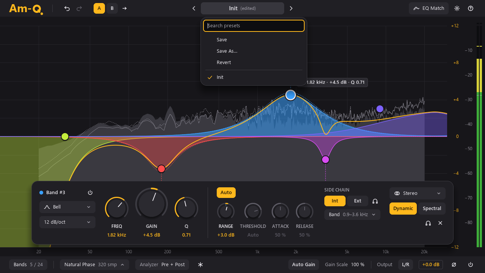

# 8 Presets

A preset stores the whole state of Am-Q: every band, the processing mode, the output settings and
the analyzer and display settings. (The interface scale belongs to your screen, not to the sound,
so loading a preset keeps the current scale.)

## The preset bar

The centre of the top bar shows the current preset's name, followed by "(edited)" once you change
anything after loading or saving it.

- **‹** and **›** load the previous or next preset in the list. At the end of the list they wrap
  around.
- Click the **name** to open the preset menu.

## The preset menu



- **Search presets:** the field at the top is ready for typing as soon as the menu opens. Type
  part of a name or a folder name to list the matching presets; several words narrow the search
  (every word must match). Up and Down move the highlight, **Enter** loads the highlighted preset,
  Backspace edits the search, and **Escape** clears the search (press it again to close the menu).
  At most 12 matches are listed; keep typing to narrow them down.
- **Save:** saves over the current preset file. For a preset that has no file yet (Init, or a
  new state), it works like Save As.
- **Save As…:** opens a save dialog in your preset folder. Choose a name, or a subfolder, and
  save.
- **Revert:** reloads the current preset, discarding your changes. Available while the preset is
  edited.
- The **list:** **Init** first, then your presets. Presets in subfolders appear in submenus named
  after the folder. The current preset has a check mark. Click a preset to load it.

**Init** is the built-in starting point: no bands, every setting at its default.

## Preset files

Presets are files with the extension `.amqpreset`, in your preset folder:

```
%APPDATA%\Am-Q\Presets
```

(usually `C:\Users\<you>\AppData\Roaming\Am-Q\Presets`). Am-Q creates the folder the first time
you save.

- **Folders are categories.** Create subfolders (in the save dialog or in Explorer) to group your
  presets, for example `Vocals` or `Mastering`. The list sorts by folder, then by name, ignoring
  upper and lower case.
- **Sharing.** A preset file works on any computer with Am-Q: copy it into the other preset
  folder. Presets from a newer version of Am-Q load in older versions as far as they can: settings
  an older version does not know are ignored.
- Am-Q writes preset files safely: if saving fails (for example, the disk is full), the old file
  is left intact and Am-Q shows a message.

## Presets and your host

- Loading a preset is not an undo step, and it clears the undo history.
- Your host saves the name of the current preset with the project, so the preset bar shows the
  right name when you reopen it.
- Am-Q's presets are separate from your host's own preset system. Saving a host preset of Am-Q
  works too; it stores the same state.
