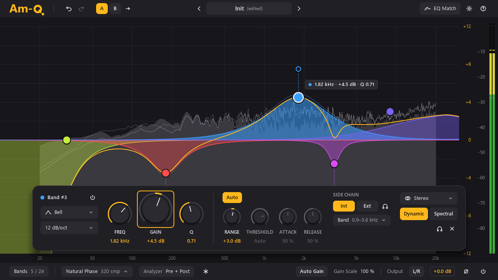
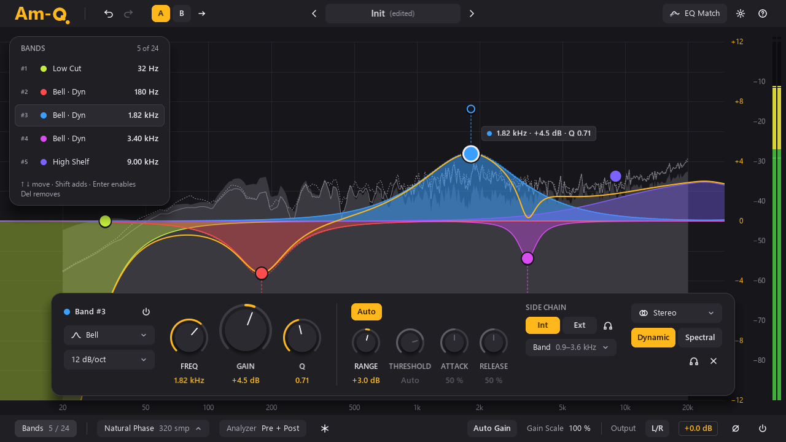
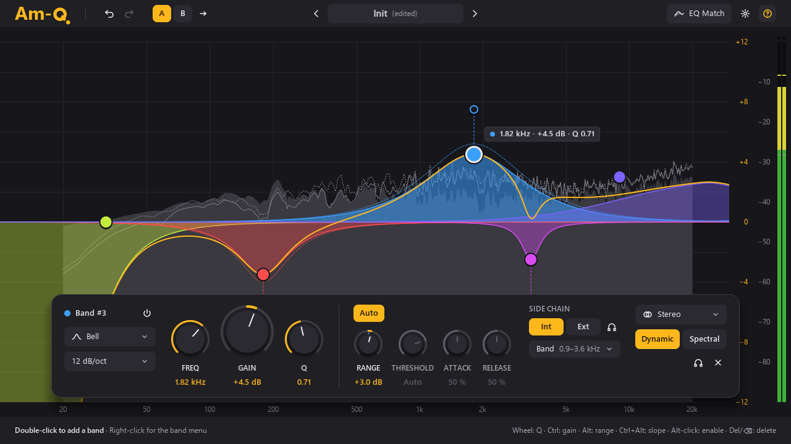

# 9 Keyboard, hints and tooltips

## Keys

Am-Q uses the keyboard only while its window has the focus (click in it first), and only for the
keys below. **Every other key goes to your host**, so the space bar still starts and stops
playback, and your host's shortcuts keep working while Am-Q is open.

**On the graph** (after clicking a band or empty graph):

| Key | Does |
| --- | --- |
| Tab / Shift+Tab | Focus the next or previous band, in frequency order |
| ← / → | Frequency down or up by 1/12 octave (Shift: 1/96 octave) |
| ↑ / ↓ | Gain up or down by 0.5 dB (Shift: 0.1 dB). For bands without gain: Q |
| Delete, Backspace | Delete the selected bands (or the focused band) |
| Ctrl+A | Select all bands |
| Ctrl+X, Ctrl+C, Ctrl+V | Cut, copy, paste bands |
| Ctrl+Z | Undo |
| Ctrl+Shift+Z, Ctrl+Y | Redo |
| Enter | Move into the focused band's panel (below) |
| Escape | Cancel a drag; otherwise close the open menu; otherwise clear the selection |

**In the band panel** (after Enter on a band):

| Key | Does |
| --- | --- |
| Tab / Shift+Tab | Next or previous control, round in a loop |
| ↑ / ↓ | Raise or lower the focused control (Shift: a tenth of the step for knobs) |
| Enter | Press the focused control: switch a toggle, step through a choice, or delete the band on the × |
| Escape | Back to the band on the graph |

The focused control has an orange ring.

If the panel is folded into a strip (a small window, chapter 1), Enter opens it and Escape folds
it again.

**In the band list** (chapter 1, **Bands** in the status bar):

| Key | Does |
| --- | --- |
| ↑ / ↓ | Move to the previous or next band (Shift extends the selection) |
| Enter | Switch the band on or off |
| Delete | Delete the band |

**In a value editor** (typing a value):

| Key | Does |
| --- | --- |
| Enter | Apply |
| Tab | Apply and move to the next field |
| Escape | Cancel |

While you type in a value editor or the preset search, the field takes every key.

**In the preset menu:** typing searches; ↑ / ↓ move; Enter loads; Escape clears the search, then
closes (chapter 8).

## The band list

Click **Bands** in the status bar for a list of every band in use, in frequency order, with its
number, colour, shape and frequency. " · Dyn", " · Spec", " · off" and " · Solo" mark dynamic,
spectral, disabled and soloed bands. Clicking a row selects the band, and the list stays open
while you work on the graph; clicking empty graph closes it.

## Hint mode

Click **?** in the top bar to show the main gestures in the status bar instead of its controls.
Click it again, or press Escape, to bring the controls back.

## Tooltips

Hold the pointer still over any control for a moment to see what it does and its shortcut, where
it has one. Attack and Release show the actual time they give at the band's frequency.
