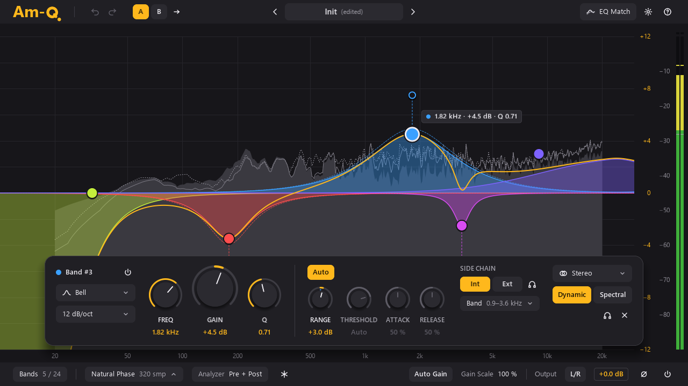

# Am-Q user guide

Am-Q is a 24-band parametric equalizer with dynamic and spectral bands, three phase modes, a
real-time analyzer and EQ Match. This guide covers every feature of the current version
(0.0.1, Windows, CLAP and VST3).

## Contents

1. [Getting started](01-getting-started.md): installing, loading Am-Q in a host, and a tour of
   the window.
2. [Working on the graph](02-graph.md): adding, selecting, moving and shaping bands with the
   mouse, the band menu, copy and paste, undo.
3. [The band panel](03-band-panel.md): every control of a band, shape by shape: the filter,
   placement, dynamics, side chain, spectral processing, solo.
4. [Processing modes and latency](04-processing-modes.md): Zero Latency, Natural Phase,
   Linear Phase and their resolution.
5. [Output, gain and bypass](05-output.md): output level and pan, Auto Gain, Gain Scale,
   Solo Gain, polarity and bypass.
6. [Analyzer, meters and display](06-analyzer-and-display.md): the analyzer layers and
   settings, the meters, the display range and the interface scale.
7. [EQ Match](07-eq-match.md): matching your track's tonal balance to a reference.
8. [Presets](08-presets.md): saving, loading, searching and organising presets.
9. [Keyboard, hints and tooltips](09-keyboard.md): every key, hint mode and tooltips.
10. [Reference](10-reference.md): parameter ranges, typing values, latency tables, limits of
    this version and troubleshooting.

## Conventions

- **Ctrl** means the Control key. **Alt** means the Alt key.
- "Click" means the left mouse button. "Right-click" is the right button.
- Values are written the way Am-Q shows them: "1.82 kHz", "+4.5 dB", "Q 0.71".
- Screenshots are of the editor at its default size, 1280 × 720, and 100 % interface scale.
